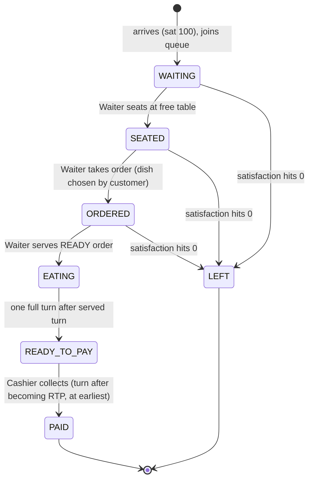
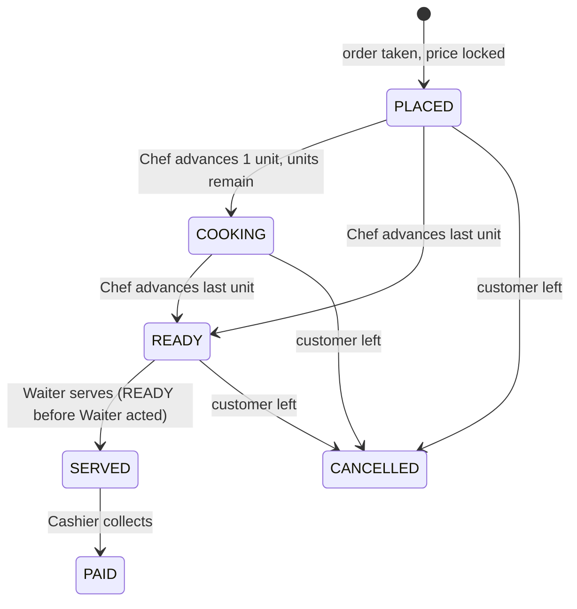
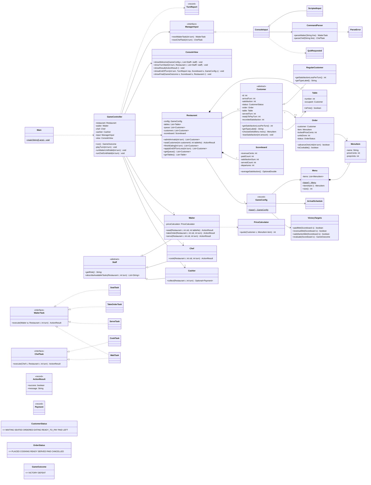
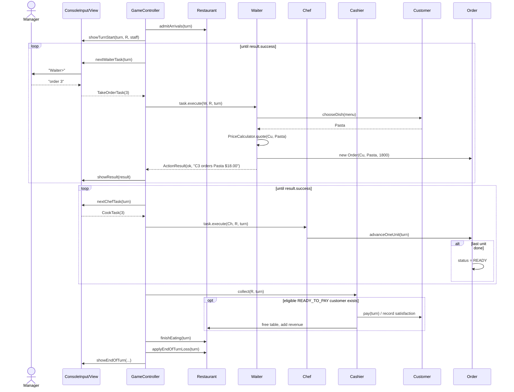

# Restaurant Rush: Stage 1 Development Plan

> SC2002 Group Assignment: Java CLI turn-based restaurant management game
> Scope of this document: **ideation, game design, architecture, implementation, testing, Git workflow and handoff for Stage 1**, plus the extension points that Stage 2 and Stage 3 will plug into.
> Out of scope: the recorded video, and the PDF report or documentation owned by the Stage 3 member. Section 13 lists the raw evidence Stage 1 must leave behind for that member.

---

## Table of contents

0. [How to use this document](#0-how-to-use-this-document)
1. [The brief, decoded](#1-the-brief-decoded)
2. [Ideation: evaluating our own ideas](#2-ideation-evaluating-our-own-ideas)
3. [Stage 1 game design](#3-stage-1-game-design)
4. [Rules specification (implementation-ready)](#4-rules-specification-implementation-ready)
5. [Architecture](#5-architecture)
6. [Class-by-class specification](#6-class-by-class-specification)
7. [CLI design](#7-cli-design)
8. [Project setup and build](#8-project-setup-and-build)
9. [Git workflow and tagging](#9-git-workflow-and-tagging)
10. [Work split for the two Stage 1 developers](#10-work-split-for-the-two-stage-1-developers)
11. [Testing plan, including the reproducible runs](#11-testing-plan-including-the-reproducible-runs)
12. [Stage 1 Definition of Done](#12-stage-1-definition-of-done)
13. [Handoff to Stage 2, Stage 3 and the report writer](#13-handoff-to-stage-2-stage-3-and-the-report-writer)
14. [Open decisions to confirm as a team](#14-open-decisions-to-confirm-as-a-team)

---

## 0. How to use this document

- **Stage 1 devs (2 people):** read everything. Sections 4 to 7 are the contract you code against, and Section 10 says who does what.
- **Stage 2 dev:** read sections 1, 3, 5, 6 and 13.1. Your work should add classes, not rewrite the Stage 1 ones.
- **Stage 3 dev:** read sections 1, 5, 6 and 13.2. Section 13.3 lists the evidence you will collect for the report.
- When the code disagrees with this document, fix one of them in the same PR. Do not let them drift apart, because the class diagram (25 marks) must match the code.

---

## 1. The brief, decoded

### 1.1 Hard constraints (non-negotiable)

| # | Constraint | Where it bites us |
|---|---|---|
| H1 | Java, command-line, turn-based | No GUI; the GUI earns no marks |
| H2 | **Base setting must always be available:** 18 turns, 2 tables, 1 Waiter, 1 Chef, 1 Cashier, arrivals at turns 1, 4, 7, 10, 13, 16 | `GameConfig.base()` must be the default and must reproduce exactly |
| H3 | Menu: Salad $9.00/1 unit, Burger $15.00/1, Pasta $18.00/2 | Data in `Menu.base()` |
| H4 | Win: ≥4 paid **AND** revenue ≥ $45 **AND** avg satisfaction of paid customers ≥ 60 | `VictoryTargets` |
| H5 | **Customers choose their own food** with a documented deterministic rule or seeded randomness; show the choice when ordered | `Customer.chooseDish(Menu)` |
| H6 | **Rules must stay out of the UI.** The UI only collects decisions and displays state | Strict package boundary (`ui` → `control` → `domain`) |
| H7 | Money as **integer cents**; display `$x.xx` | `int` everywhere, `Money.format` |
| H8 | Fully offline | No network libraries; no runtime dependencies |
| H9 | Six turn steps in a fixed order (Section 4) | `GameController.playTurn` |
| H10 | **Invalid choice → explain why → re-prompt → staff task NOT consumed** | `ActionResult` + retry loop |
| H11 | Always run all 18 turns; no early end | Loop is `for turn in 1..18` |
| H12 | Start-of-turn display + end-of-turn results with exact fields | `ConsoleView` |
| H13 | Stage 1 at Git tag `stage-1`, compiles and runs alone, **no Stage 2/3 features** | No VIP, Critic, Host, Combo or Happy Hour code in that commit |
| H14 | Stage 1 test notes: **one reproducible victory run + one reproducible defeat run** | `scripts/*.txt` + `docs/test-notes/stage-1.md` |

### 1.2 Things we are free to decide

- Class names, packages, patterns. The brief says not to create interfaces just to tick a box, so every interface we add must have a reason we can state.
- The rule for how customers choose food.
- Command syntax and screen layout.
- Optional extra difficulty settings, as long as the base setting stays intact.

### 1.3 How marks map to Stage 1 work

| Criterion | Marks | What Stage 1 contributes |
|---|---|---|
| Class diagram | 25 | The *shape* of the final diagram is set here. A clean Stage 1 means Stage 2/3 only add boxes |
| Sequence diagram | 20 | The arrival → order → READY → SERVED → eat → pay → result-check flow is all Stage 1 code |
| Design consideration | 15 | SRP/OCP/LSP/DIP claims only hold up if Stage 1 is designed for extension |
| Implementation | 20 | "Stage 1 core game" + reproducibility (scripts) + code quality |
| Process | 20 | Commit history with reasons, the `stage-1` tag, test notes |

In practice Stage 1 decides most of the grade. If Stage 1 is designed well, Stages 2 and 3 can be done by adding classes, and that is the OCP story the report needs.

---

## 2. Ideation: evaluating our own ideas

The ideas from the group chat, checked against the brief:

### Idea A: "Fill in the seats with a set time assigned to each customer"

> "instead of the dude making it now, just fill in the seats with a set 'time' assigned to each customer"

**Verdict: adapt it. We can't replace the Chef.** The brief requires a Chef who advances orders by **one preparation unit per turn**, and the kitchen is one of the three staff resources the manager has to prioritise. An automatic per-customer timer would remove one of the two decisions that matter each turn, and it would break the H9 turn steps.

**What we keep:** the "time" idea is already there in two forms:
- **Prep units per dish** (Salad 1, Burger 1, Pasta 2) act as the "time" of the order.
- **Eating is a fixed 1 full turn** under the brief, so it can't vary per customer in the base setting.

### Idea B: "Select which person sits where, with slots to fill up"

**Verdict: adopt it as the core interaction.** This is exactly the Waiter's *seat* task. Our seat command takes **both a customer and a table**:

```
seat 4 2      -> seat customer C4 at table T2
seat 4        -> seat C4 at the lowest-numbered free table (convenience)
```

The "slots" are the 2 tables, shown every turn as a seating board (Section 7.2). Because the manager picks *which* queued customer to seat (not forced FIFO), seating priority becomes a real choice, which is what the brief asks for in Section 4.1.

### Idea C: "More menu items with different prep times as progression / harder levels"

**Verdict: keep it as an optional extra difficulty setting (stretch goal), never touching the base.**

- The brief allows optional difficulty settings in Section 2.1, but extras only earn credit "when they show sound design and do not replace required rules."
- The sound-design version is to make the game **data-driven** (`GameConfig` holds menu, tables, turns, arrivals and targets). A harder setting then needs **zero new rule code**, just a new `GameConfig.rush()` factory. That gives the report a concrete OCP example.
- It is selected with a **command-line flag** (`--setting rush`), not a start-up prompt, so the base run (and every TA reproduction script) is unaffected.
- Do it **only after** every item in the Stage 1 Definition of Done is ticked. It goes in before the `stage-1` tag, or not at all. Don't mix it into Stage 2/3 commits.
- Note that Stage 3's **ComboMeal** already adds menu variety and prep-time variety. Our extra setting must not look like a half-built Stage 3 feature, so it contains **single dishes only** (e.g. Steak $24.00 / 3 units).

Proposed stretch setting (not required):

| Setting | Turns | Tables | Arrivals | Menu additions | Targets |
|---|---|---|---|---|---|
| `base` (default) | 18 | 2 | 1,4,7,10,13,16 | none | 4 paid / $45 / 60 |
| `rush` (stretch) | 24 | 3 | every 2 turns from 1 (12 total) | Steak $24.00 / 3 units | 8 paid / $110 / 60 (tune after playtesting) |

### Idea D (mine): manager-chosen priority everywhere, never FIFO

The brief says the player "sets seating, ordering and serving priority through the Waiter, and kitchen priority through the Chef." So:
- The Waiter can seat **any** queued customer, take **any** seated customer's order, and serve **any** READY order.
- The Chef can cook **any** unfinished order.
- Only the Cashier is automatic (oldest first), as the brief requires.

---

## 3. Stage 1 game design

### 3.1 The player fantasy and core tension

You are the manager of a tiny 2-table restaurant with **one waiter who can only do one thing per turn**. Every customer needs **three waiter actions** (seat → take order → serve), and a new customer arrives **every three turns**. With 1-unit dishes the waiter is exactly fully booked. **Pasta (2 units) pushes the serve one turn later**, so it collides with the next arrival's seating. That collision is the main decision in the game: serve the Pasta now, or seat the new arrival who is already losing satisfaction in the queue?

Every turn the manager also decides what the Chef cooks, and has to avoid wasting Chef turns.

### 3.2 Customer food-choice rule (documented, deterministic)

> **Rule F1:** Customer `Cn` (n = arrival order, starting at 1) orders `menu.items[(n − 1) mod menuSize]`.
> With the base menu `[Salad, Burger, Pasta]`, arrivals order:
> C1 Salad, C2 Burger, C3 Pasta, C4 Salad, C5 Burger, C6 Pasta.

Why this rule:
- **Deterministic**, so the TA can reproduce runs without a seed.
- **Lives in the customer object** (`Customer.chooseDish(Menu)`), not the UI, so Stage 2's Critic can override it polymorphically (the brief explicitly wants Critic's order preference to be distinct).
- The manager does not see the dish until the order is taken (shown on the order screen, as H5 requires).
- It puts a Pasta on C3 and C6, which creates the waiter collisions described in 3.1.

> ⚠ **Stage 3 note:** when combos are added to the menu, `menuSize` changes and the rotation changes too. Stage 3 must document its own combo-choice rule (e.g. "every customer whose id is a multiple of 3 picks a combo") and must not silently change which base dishes the earlier customers order. This is flagged in Section 13.2.

### 3.3 Feasibility proof: optimal play wins comfortably

I worked through the optimal line by hand under the exact rules in Section 4. This is also our **reproducible victory script** (Section 11.3).

| Turn | Arrival | Waiter | Chef | Auto (cashier / eating) | Satisfaction at end of turn |
|---|---|---|---|---|---|
| 1 | C1 | seat C1 → T1 | wait | | C1 92 |
| 2 | | order C1 (**Salad**) | cook C1 → READY | | C1 84 |
| 3 | | serve C1 | wait | | C1 84 (eating, no loss) |
| 4 | C2 | seat C2 → T2 | wait | C1 → READY_TO_PAY | C2 92 |
| 5 | | order C2 (**Burger**) | cook C2 → READY | **C1 pays $9.00 (84)**, T1 freed | C2 84 |
| 6 | | serve C2 | wait | | C2 84 |
| 7 | C3 | seat C3 → T1 | wait | C2 → READY_TO_PAY | C3 92 |
| 8 | | order C3 (**Pasta**) | cook C3 (1/2) | **C2 pays $15.00 (84)**, T2 freed | C3 84 |
| 9 | | wait *(nothing to do)* | cook C3 (2/2) → READY | | C3 76 |
| 10 | C4 | serve C3 *(collision: C4 waits)* | wait | | C3 76, C4 92 |
| 11 | | seat C4 → T2 | wait | C3 → READY_TO_PAY | C4 84 |
| 12 | | order C4 (**Salad**) | cook C4 → READY | **C3 pays $18.00 (76)**, T1 freed | C4 76 |
| 13 | C5 | serve C4 *(C5 waits)* | wait | | C4 76, C5 92 |
| 14 | | seat C5 → T1 | wait | C4 → READY_TO_PAY | C5 84 |
| 15 | | order C5 (**Burger**) | cook C5 → READY | **C4 pays $9.00 (76)**, T2 freed | C5 76 |
| 16 | C6 | serve C5 *(C6 waits)* | wait | | C5 76, C6 92 |
| 17 | | seat C6 → T2 | wait | C5 → READY_TO_PAY | C6 84 |
| 18 | | order C6 (**Pasta**) | cook C6 (1/2) | **C5 pays $15.00 (76)**, T1 freed | C6 76 |

**Result:** 5 paid, revenue **$66.00**, average satisfaction (84+84+76+76+76)/5 = **79.2**, 0 departures → **VICTORY**.

The design consequences:
- The base game is **winnable with margin**. The brief caps payers at 5 because C6 arrives too late.
- The collision at Turn 10 shows **one Pasta delays everyone after it by one turn**, which costs 8 satisfaction per later customer.
- **Bad play loses quickly.** Stop serving after Turn 10 and you finish with 3 paid / $42.00 → DEFEAT (Section 11.3, defeat run B), even though the average satisfaction is 81.3. Wasting waiter turns early pushes later customers below 60.
- If playtesting shows it is too easy, **do not change the base**. Put difficulty in the optional `rush` setting.

### 3.4 What the manager sees and decides each turn

1. Read the board (queue, tables, kitchen, payers, available tasks).
2. Give **one Waiter command** (seat / order / serve / wait).
3. Give **one Chef command** (cook / wait). This prompt comes *after* the Waiter acts, so the Chef can cook the order just taken.
4. Watch the automatic phase: payments, eating finishing, satisfaction loss, walk-outs.
5. Read the end-of-turn results.

---

## 4. Rules specification (implementation-ready)

This is the source of truth for coding and unit tests. Every rule has an ID so test names and commit messages can refer to it (e.g. `test_R5_2_decayFloorsAtZero`).

### 4.1 Entities and states

**Customer status** (`CustomerStatus` enum):



**Order status** (`OrderStatus` enum):



**Table:** `free` or `occupied by exactly one Customer`. Occupied from seating until that customer **pays or leaves** (R-A1).

"Awaiting service" = customer status ∈ {WAITING, SEATED, ORDERED}. This is the set that loses satisfaction.

### 4.2 Turn sequence (exact order)

```
for turn = 1 .. config.maxTurns:            // 18, never ends early (R6.1)
   STEP 1  Arrivals
   DISPLAY start-of-turn board
   STEP 2+3a  Waiter: prompt -> validate -> execute (retry until valid)
   STEP 2+3b  Chef:   prompt -> validate -> execute (retry until valid)
   STEP 4a  Cashier: collect from at most one eligible READY_TO_PAY customer
   STEP 4b  Eating: customers served on an earlier turn -> READY_TO_PAY
   STEP 5   Satisfaction loss and abandonment
   DISPLAY end-of-turn results
STEP 6  Evaluate victory/defeat, show final summary
```

Why the Waiter prompt is executed *before* the Chef prompt is shown: the brief says "the Waiter acts before the Chef" and "the Chef may work on an order the Waiter took this turn". Running the Waiter first means the Chef's options already include the new order, and it also guarantees R3.2 (a dish finished this turn can't be served this turn), because the Chef only acts after the Waiter's serve opportunity has passed.

### 4.3 Rules by step

**Step 1: Arrivals**
- **R1.1** At the start of each turn listed in the arrival schedule (base: 1, 4, 7, 10, 13, 16), create exactly one customer with satisfaction **100**, status WAITING, and append them to the waiting queue.
- **R1.2** Customer ids are assigned in arrival order: C1…C6.
- **R1.3** Arrivals happen *before* the board is displayed, so the manager can act on the newcomer this turn.

**Step 2/3a: Waiter (at most one task)**
- **R2.1** Options: `seat`, `order`, `serve`, `wait`. Exactly one valid action per turn.
- **R2.2 seat(c, t):** valid iff `c` is in the queue (WAITING) **and** table `t` exists and is free. Effect: remove `c` from the queue, occupy `t`, `c` → SEATED.
- **R2.3 order(c):** valid iff `c` is SEATED (seated with no order yet). Effect: `dish = c.chooseDish(menu)`; `price = PriceCalculator.quote(c, dish)` (locked now); create Order(PLACED, unitsDone 0); `c` → ORDERED; **display the dish and price**.
- **R2.4 serve(c):** valid iff `c` is ORDERED and their order is **READY**. Effect: order → SERVED, `c` → EATING, record `servedTurn = turn`, `servedCount++`.
- **R2.5 wait:** always valid; consumes the Waiter's turn.
- **R2.6** An invalid command prints the reason (Section 7.4) and re-prompts. **The Waiter's task is not consumed** (R-A4).

**Step 2/3b: Chef (at most one preparation unit)**
- **R3.1 cook(c):** valid iff `c` has an order in PLACED or COOKING. Effect: `unitsDone++`; if `unitsDone == prepUnits` → READY (record `readyTurn`), else → COOKING.
- **R3.2** An order that becomes READY this turn can't be served this turn. This is guaranteed by the Waiter-before-Chef execution order; there is no extra flag to check.
- **R3.3** The Chef may cook an order taken by the Waiter this same turn.
- **R3.4 wait:** always valid. An invalid command re-prompts without consuming.

**Step 4a: Cashier (automatic)**
- **R4.1** Eligible = customers with status READY_TO_PAY **and** `readyToPayTurn < currentTurn`.
- **R4.2** Process **at most one**: the oldest by `readyToPayTurn`, ties broken by lower customer id.
- **R4.3** Payment: `revenue += order.lockedPrice`; customer → PAID with `recordedSatisfaction = current satisfaction`; order → PAID; table freed; `paidCount++`, `satisfactionSum += recorded`.

**Step 4b: Eating (automatic)**
- **R4.4** Every EATING customer with `servedTurn < currentTurn` → READY_TO_PAY, `readyToPayTurn = currentTurn`.
- (4a runs before 4b. Because of the `<` checks in R4.1/R4.4 the order between them doesn't change outcomes, but keep it fixed so logs are stable.)

**Step 5: Satisfaction loss and abandonment**
- **R5.1** Every customer *awaiting service* (WAITING, SEATED, ORDERED) loses `customer.getSatisfactionLossPerTurn()` (Regular = 8).
- **R5.2** Satisfaction never goes below 0.
- **R5.3** A customer at 0 leaves immediately: status LEFT; removed from the queue *or* table freed; any order not yet SERVED → CANCELLED; `departures++`. **No revenue.**
- **R5.4** EATING, READY_TO_PAY, PAID and LEFT customers lose nothing.
- **R5.5** Customers who arrived this turn also lose satisfaction at the end of this turn (as in the brief's example: seated on turn 1 → 92).

**Step 6: Result**
- **R6.1** The game always plays all `maxTurns`.
- **R6.2** VICTORY iff `paidCount ≥ 4` **and** `revenueCents ≥ 4500` **and** `averagePaidSatisfaction ≥ 60`; otherwise DEFEAT.
- **R6.3** Compare the average without floating point: `satisfactionSum ≥ 60 × paidCount` (and `paidCount > 0`).

**Always-on rules**
- **R-A1** A table stays occupied until its customer pays or leaves.
- **R-A2** A customer can't eat before being served; the Cashier can't charge before READY_TO_PAY.
- **R-A3** Revenue never includes unpaid or abandoned orders.
- **R-A4** Invalid choices explain and re-prompt without consuming the staff task.
- **R-A5** The turn-16 arrival can't pay within 18 turns. This is intended; mention it in the README/test notes so a TA doesn't think it's a bug.

### 4.4 Display rules

- **D1 Start of turn:** turn number, revenue, average satisfaction of paid customers (or `N/A`), waiting queue, occupied tables, **each customer's satisfaction**, **order status**, **staff tasks available**.
- **D2 End of turn:** served count, unhappy departures, revenue, average satisfaction of paid customers (`N/A` if none), turns used (`turn / 18`).
- **D3** Show the dish choice when an order is placed.
- **D4** Average satisfaction is displayed to 1 decimal place.
- **D5** Money is always shown via `Money.format`, e.g. `$18.00`.

### 4.5 Edge cases that must be handled (and tested)

| Case | Expected |
|---|---|
| `seat` when both tables are occupied | Rejected: "No free table…". Waiter re-prompted |
| `seat 4 2` but T2 occupied, T1 free | Rejected with a hint: "Table 2 is occupied by C2. Free tables: 1" |
| `seat` a customer who is already seated, left or paid | Rejected with their actual status |
| `order` for a customer who already ordered | Rejected: "C3 has already ordered Pasta (COOKING 1/2)" |
| `serve` an order that's COOKING | Rejected: "not READY (1/2 units done)" |
| `cook` a READY / SERVED / CANCELLED order | Rejected with status |
| `cook` for a customer with no order | Rejected |
| Customer leaves while their order is cooking | Order CANCELLED; it disappears from the Chef's options; table freed |
| Two customers READY_TO_PAY on the same eligible turn | Only the oldest pays; the other pays next turn |
| Non-numeric ids, extra args, empty line, unknown command, mixed case (`SEAT c3 T1`) | Parse error explained, re-prompt; case-insensitive, `C`/`T` prefixes optional |
| End of input (stdin closed / script ends) | Script → fall back to interactive; stdin closed → treat remaining prompts as `wait` and finish the game cleanly (never crash) |
| No paid customers | Average shown as `N/A`; result DEFEAT |

---

## 5. Architecture

### 5.1 Layers (Entity-Control-Boundary)

```
rush.ui        (Boundary)  ConsoleView, ConsoleInput, ScriptedInput, CommandParser
    │ depends on
    ▼
rush.control   (Control)   GameController, ManagerInput (interface)
    │ depends on
    ▼
rush.domain    (Entity)    Restaurant, Customer, Order, Table, Menu, staff, tasks, rules
```

- **Dependencies only point downward.** `domain` imports nothing from `control` or `ui`. Check this in code review with `grep -r "import rush.ui" src/main/java/rush/domain` (it should return nothing).
- **`domain` never calls `System.out` or reads input.** It returns values (`ActionResult`, `Payment`, lists of departed customers) that the view formats. This is how we meet H6.
- **One `domain` package** (not sub-packages) so state-changing methods can be **package-private**. The UI can call getters but cannot call `customer.seatAt(...)`. That's the encapsulation example for the report.

### 5.2 Design decisions and their justification (for the report)

| Decision | Principle / pattern | Why it is real (not checklist) |
|---|---|---|
| `Customer` is **abstract**, `RegularCustomer` concrete | Inheritance, polymorphism, **OCP**, **LSP** | Stage 2 adds `VIPCustomer`/`CriticCustomer` by subclassing; the controller never checks types (the brief requires this) |
| `getSatisfactionLossPerTurn()`, `chooseDish(Menu)` are polymorphic on `Customer` | Polymorphism | Satisfaction loss and dish choice already vary in Stage 2 |
| `ManagerInput` interface with `ConsoleInput` + `ScriptedInput` | **DIP** | The controller depends on an abstraction; two real implementations exist now (interactive + reproducible script runs), and tests use a third |
| Waiter/Chef commands are `WaiterTask`/`ChefTask` objects (Command pattern) | Polymorphism, **SRP** | The parser builds a task; the staff member executes it; failure returns an `ActionResult` and doesn't consume the turn. No `switch` on command type in the controller |
| Seating logic is in `Restaurant.seatCustomer(...)`, and the Waiter delegates to it | **DRY / OCP** | Stage 3's Host seats customers too, so it reuses this method instead of copying it |
| Abstract `Staff` with `describeAvailableTasks(...)` | Polymorphism, **OCP** | The start-of-turn board loops over `List<Staff>`; Stage 3 adds a Host to the list without touching the view |
| `PriceCalculator.quote(customer, item)`: the single place a price is locked | **SRP**, extension point | Stage 2 VIP discount and Stage 3 Happy Hour are both "price at order time". One method changes, and nothing else does |
| `MenuItem` is an immutable class, **not final** | Composition (Stage 3) | `ComboMeal` can compose two `MenuItem`s and present itself as a `MenuItem` (Composite-lite) |
| `GameConfig` (turns, tables, arrivals, menu, targets) injected into `Restaurant` | **OCP**, testability | The base setting is one factory; tests build tiny configs (e.g. one Pasta customer to replay the brief's §3.3 example) |
| Composition: `Restaurant` *has* `Table`s, a waiting queue, `Customer`s, a `Scoreboard`; `Customer` *has* an `Order`; `Order` *references* a `MenuItem` | Composition | Clear ownership; easy multiplicities for the class diagram |

**Alternative we considered (for the report's trade-off section):** a single `GameEngine` god-class with a big `switch(command)` and customers as a `type` field. Rejected because every Stage 2/3 feature would mean editing that class (OCP violation) and the brief explicitly bans type-check chains for customer behaviour. Record this in `docs/design-log.md` (Section 13.3).

**Interfaces we deliberately did NOT add:** `ITable`, `IOrder`, `IMenu`, `IView`. Each has only one implementation and no planned variation, and the brief warns against interfaces "just to satisfy a checklist." Note this in the design log too, because it's a good ISP/YAGNI discussion point.

### 5.3 Stage 1 class diagram (target)



(`TurnReport` is a small record the controller fills during the automatic phase: `Optional<Payment> payment`, `List<Customer> finishedEating`, `List<Customer> departed`.)

### 5.4 Sequence of one turn (reference for the sequence diagram)



---

## 6. Class-by-class specification

Conventions: all fields `private` (and `final` where possible); collections are returned as `List.copyOf(...)` or `Collections.unmodifiableList(...)`; state-changing domain methods are **package-private** unless the UI or control layer genuinely needs them. Javadoc on every public method. Java 17 language level (records allowed; no preview features).

### 6.1 `rush.domain`

#### `Money` (utility, final, private constructor)
```java
public static String format(int cents)            // 1830 -> "$18.30", 5 -> "$0.05"
```
(Do **not** add percentage/discount helpers in Stage 1. Stage 2 adds `Money.percentOf(cents, pct)` with round-half-up.)

#### `MenuItem` (immutable, not final)
```java
public MenuItem(String name, int priceCents, int prepUnits) // validate >0
public String getName(); public int getPriceCents(); public int getPrepUnits();
public String toString() // "Pasta ($18.00, 2 units)"
```

#### `Menu`
```java
public Menu(List<MenuItem> items)                 // copies list
public static Menu base()                         // Salad 900/1, Burger 1500/1, Pasta 1800/2, in this order
public MenuItem itemAt(int index); public int size(); public List<MenuItem> getItems();
```

#### `CustomerStatus` enum
`WAITING, SEATED, ORDERED, EATING, READY_TO_PAY, PAID, LEFT` with a helper `boolean isAwaitingService()` (true for the first three).

#### `Customer` (abstract)
```java
public static final int MAX_SATISFACTION = 100;
protected Customer(int id, int arrivalTurn)

// polymorphic behaviour (Stage 2 overrides these)
public abstract int getSatisfactionLossPerTurn();
public abstract String getTypeLabel();            // "Regular"
public MenuItem chooseDish(Menu menu)             // Rule F1: menu.itemAt((id-1) % menu.size())

// queries
public int getId(); public String getLabel();     // "C3"
public int getArrivalTurn(); public int getSatisfaction(); public CustomerStatus getStatus();
public Optional<Order> getOrder(); public Optional<Table> getTable();
public int getServedTurn(); public int getReadyToPayTurn();
public OptionalInt getRecordedSatisfaction();

// package-private transitions (each asserts the legal "from" state; throw IllegalStateException otherwise:
//  these are programmer errors, because user errors are caught earlier by validation)
void seatAt(Table t);                 // WAITING -> SEATED
void placeOrder(Order o);             // SEATED -> ORDERED
void receiveFood(int turn);           // ORDERED -> EATING, servedTurn = turn
void becomeReadyToPay(int turn);      // EATING -> READY_TO_PAY
void pay();                           // READY_TO_PAY -> PAID, recordedSatisfaction = satisfaction, table = null
void loseSatisfaction(int amount);    // clamps at 0
void leave();                         // -> LEFT, table = null
```

#### `RegularCustomer extends Customer`
`getSatisfactionLossPerTurn()` → 8; `getTypeLabel()` → "Regular". Nothing else.

#### `OrderStatus` enum
`PLACED, COOKING, READY, SERVED, PAID, CANCELLED`.

#### `Order`
```java
Order(Customer customer, MenuItem item, int lockedPriceCents, int takenTurn)
public Customer getCustomer(); public MenuItem getItem(); public int getLockedPriceCents();
public int getUnitsDone(); public int getRemainingUnits(); public OrderStatus getStatus();
public boolean isCookable()              // PLACED or COOKING
public boolean isReady()                 // READY
boolean advanceOneUnit(int turn)         // returns true if it just became READY
void markServed(); void markPaid(); void cancel();
public String progressLabel()            // "1/2"
```

#### `Table`
```java
Table(int number)
public int getNumber(); public boolean isFree(); public Optional<Customer> getOccupant();
void occupy(Customer c); void free();
```

#### `ActionResult` (record)
```java
public record ActionResult(boolean success, String message) {
  public static ActionResult ok(String msg); public static ActionResult fail(String reason);
}
```

#### `Payment` (record)
`Payment(Customer customer, int amountCents, int recordedSatisfaction, int tableNumber)`

#### `Scoreboard`
```java
public int getRevenueCents(); public int getPaidCount(); public int getServedCount(); public int getDepartures();
public int getSatisfactionSum();
public OptionalDouble averageSatisfaction()      // empty if paidCount == 0
void recordServed(); void recordPayment(int cents, int satisfaction); void recordDeparture();
```

#### `VictoryTargets` (record)
```java
public record VictoryTargets(int minPaid, int minRevenueCents, int minAvgSatisfaction) {
  public static VictoryTargets base() { return new VictoryTargets(4, 4500, 60); }
  public GameOutcome evaluate(Scoreboard s)       // integer comparison, see R6.3
}
```

#### `GameOutcome` enum: `VICTORY, DEFEAT`

#### `ArrivalSchedule`
```java
public record ScheduledArrival(int turn, CustomerFactory factory) {}
@FunctionalInterface public interface CustomerFactory { Customer create(int id, int arrivalTurn); }

public ArrivalSchedule(List<ScheduledArrival> arrivals)
public static ArrivalSchedule base()   // turns 1,4,7,10,13,16 -> RegularCustomer::new
public List<ScheduledArrival> arrivalsAt(int turn)
public int totalArrivals()
```
> Why a factory per arrival: Stage 2 must put at least one VIP and one Critic into the base run. It changes **only** `ArrivalSchedule.base()` (e.g. turn 4 → `VIPCustomer::new`, turn 7 → `CriticCustomer::new`), which is a "small registration change" the brief explicitly allows.

#### `GameConfig` (record)
```java
public record GameConfig(String name, int maxTurns, int tableCount, Menu menu,
                         ArrivalSchedule arrivals, VictoryTargets targets) {
  public static GameConfig base();   // "Base", 18, 2, Menu.base(), ArrivalSchedule.base(), VictoryTargets.base()
  // public static GameConfig rush(); // STRETCH ONLY (Section 2, Idea C)
}
```

#### `PriceCalculator`
```java
public int quote(Customer customer, MenuItem item)   // Stage 1: return item.getPriceCents();
```
Stage 1 is deliberately trivial. Its job is to be *the one place* where an order's price is decided and locked. Write a Javadoc that says so.

#### `Restaurant`
```java
public Restaurant(GameConfig config)              // creates tables 1..tableCount, empty queue
public GameConfig getConfig(); public Menu getMenu(); public Scoreboard getScoreboard();
public List<Table> getTables(); public List<Table> getFreeTables();
public List<Customer> getQueue();                 // arrival order
public List<Customer> getAllCustomers();
public Optional<Customer> findCustomer(int id);
public List<Order> getCookableOrders();           // PLACED/COOKING, customer not LEFT
public List<Order> getReadyOrders();
public List<Customer> getReadyToPay();

// phases
public List<Customer> admitArrivals(int turn);                 // R1.*
public ActionResult seatCustomer(int customerId, Integer tableNoOrNull); // R2.2, shared with Stage 3 Host
public List<Customer> finishEating(int turn);                  // R4.4
public List<Customer> applyEndOfTurnLoss(int turn);            // R5.* returns customers who left
void completePayment(Customer c);                              // used by Cashier (R4.3)
```
Implementation notes:
- In `applyEndOfTurnLoss`, iterate over a **copy** of the awaiting customers (you remove from the queue while iterating).
- Leaving logic in one private method `handleDeparture(Customer)`: cancel the order if it isn't SERVED, free the table or remove from the queue, `scoreboard.recordDeparture()`.

#### `Staff` (abstract)
```java
protected Staff(String name)
public String getName();
public abstract String getRole();                                        // "Waiter"
public abstract List<String> describeAvailableTasks(Restaurant r, int turn);
```

#### `Waiter extends Staff`
```java
public ActionResult seat(Restaurant r, int customerId, Integer tableNo)  // delegates to r.seatCustomer
public ActionResult takeOrder(Restaurant r, int customerId, int turn)    // R2.3, uses PriceCalculator
public ActionResult serve(Restaurant r, int customerId, int turn)        // R2.4
describeAvailableTasks -> e.g. ["seat C4 at T2", "serve C3 (Pasta)"]
```

#### `Chef extends Staff`
```java
public ActionResult cook(Restaurant r, int customerId, int turn)         // R3.1
describeAvailableTasks -> e.g. ["cook C3 Pasta (1/2)"]
```

#### `Cashier extends Staff`
```java
public Optional<Payment> collect(Restaurant r, int turn)                 // R4.1-R4.3
describeAvailableTasks -> ["will charge C2 ($15.00) this turn"] or ["no one ready to pay"]
```

#### Tasks (Command pattern)
```java
public interface WaiterTask { ActionResult execute(Waiter w, Restaurant r, int turn); String describe(); }
public interface ChefTask   { ActionResult execute(Chef c, Restaurant r, int turn);   String describe(); }

public record SeatTask(int customerId, Integer tableNo) implements WaiterTask { ... w.seat(r, customerId, tableNo) }
public record TakeOrderTask(int customerId) implements WaiterTask { ... }
public record ServeTask(int customerId) implements WaiterTask { ... }
public record CookTask(int customerId) implements ChefTask { ... }
public final class WaitTask implements WaiterTask, ChefTask { public static final WaitTask INSTANCE; ... ok("waits") }
```

### 6.2 `rush.control`

#### `ManagerInput` (interface)
```java
WaiterTask nextWaiterTask(int turn);  // returns a syntactically valid task; handles help/status itself
ChefTask   nextChefTask(int turn);
```

#### `GameController`
```java
public GameController(Restaurant r, Waiter w, Chef c, Cashier ca, ManagerInput in, ConsoleView v)
public GameOutcome run()                         // loops all turns, then evaluates (R6)
private void playTurn(int turn)
private void runWaiterUntilValid(int turn)       // loop: task = in.nextWaiterTask; res = task.execute(...); view.showResult(res); until res.success()
private void runChefUntilValid(int turn)
```
Reference implementation of the heart of the game:

```java
public GameOutcome run() {
    view.showWelcome(restaurant.getConfig());
    for (int turn = 1; turn <= restaurant.getConfig().maxTurns(); turn++) {
        playTurn(turn);
    }
    GameOutcome outcome = restaurant.getConfig().targets().evaluate(restaurant.getScoreboard());
    view.showFinal(outcome, restaurant.getScoreboard(), restaurant.getConfig());
    return outcome;
}

private void playTurn(int turn) {
    List<Customer> arrived = restaurant.admitArrivals(turn);                 // Step 1
    view.showArrivals(arrived);
    view.showTurnStart(turn, restaurant, staff);                             // D1

    runWaiterUntilValid(turn);                                               // Steps 2-3 (Waiter first)
    runChefUntilValid(turn);                                                 // Steps 2-3 (Chef second)

    Optional<Payment> payment = cashier.collect(restaurant, turn);           // Step 4a
    List<Customer> doneEating = restaurant.finishEating(turn);               // Step 4b
    List<Customer> departed   = restaurant.applyEndOfTurnLoss(turn);         // Step 5

    view.showEndOfTurn(turn, new TurnReport(payment, doneEating, departed),
                       restaurant.getScoreboard(), restaurant.getConfig()); // D2
}
```

### 6.3 `rush.ui`

- **`CommandParser`**: pure text → task. Throws/returns a `ParseError` with a friendly message. Accepts `3`, `c3`, `C3`; tables `2`, `t2`, `T2`; case-insensitive; trims whitespace.
- **`ConsoleInput implements ManagerInput`**: reads with a `Scanner`, prints a prompt (`Waiter> `/`Chef> `), handles meta-commands (`help`, `status`, `menu`, `quit`) without returning a task, and loops on parse errors.
- **`ScriptedInput implements ManagerInput`**: holds lines from a file (skips blank lines and `#` comments), **echoes** each line after the prompt (`Waiter> seat 1 1`) so the transcript reads like a live session, and falls back to a `ConsoleInput` when lines run out.
- **`ConsoleView`**: all formatting. **ASCII only** (no box-drawing or `→` characters; Windows consoles default to cp1252 and will print garbage).

### 6.4 `rush.Main`

```
java -cp out rush.Main                         # interactive, base setting
java -cp out rush.Main scripts/victory.txt     # replay a script, then continue interactively if it runs out
java -cp out rush.Main --setting rush          # STRETCH only
```
Main wires everything: `GameConfig.base()` → `Restaurant` → staff → input → view → `GameController.run()`. Catch `QuitRequested` for a clean exit.

---

## 7. CLI design

### 7.1 Welcome screen

```
==============================================================
  RESTAURANT RUSH  -  Stage 1                     setting: Base
==============================================================
 18 turns | 2 tables | Waiter x1, Chef x1, Cashier x1
 Customers arrive on turns 1, 4, 7, 10, 13, 16.
 WIN at end of turn 18: >= 4 paid AND revenue >= $45.00
                        AND avg satisfaction (paid) >= 60
 Menu: Salad $9.00 (1 unit) | Burger $15.00 (1) | Pasta $18.00 (2)
 Type 'help' at any prompt for commands.
==============================================================
```

### 7.2 Start-of-turn board (D1)

```
--------------------------------------------------------------
 TURN 10 / 18     Revenue $24.00     Avg satisfaction (paid) 84.0
--------------------------------------------------------------
 >> C4 (Regular) arrives and joins the queue.

 WAITING QUEUE
   C4  Regular  sat 100  waiting since turn 10

 TABLES
   T1  C3  Regular  sat  76  ORDERED   Pasta   READY (2/2)  $18.00
   T2  -- free --

 KITCHEN
   C3  Pasta  READY

 PAID SO FAR
   C1  $9.00  sat 84   |   C2  $15.00  sat 84

 STAFF TASKS AVAILABLE
   Waiter : seat C4 at T2 | serve C3 (Pasta)
   Chef   : nothing to cook
   Cashier: no one ready to pay (automatic)
--------------------------------------------------------------
Waiter> serve 3
  OK: Waiter serves Pasta to C3.
Chef> wait
  OK: Chef waits.
```

### 7.3 End-of-turn results (D2)

```
 END OF TURN 10
   * C4 loses 8 satisfaction (100 -> 92)
 Served 3 | Unhappy departures 0 | Revenue $24.00 | Avg sat (paid) 84.0 | Turns used 10/18
```
Final screen: the same numbers, plus a checklist of the three targets with PASS/FAIL, then `*** VICTORY ***` or `*** DEFEAT ***`.

```
 FINAL RESULT
   Paid customers   5   (need >= 4)       PASS
   Revenue     $66.00   (need >= $45.00)  PASS
   Avg satisfaction 79.2 (need >= 60)     PASS
 *** VICTORY ***
```

### 7.4 Commands and error messages

| Prompt | Command | Meaning |
|---|---|---|
| Waiter | `seat <c> [t]` | Seat customer c at table t (default: lowest free) |
| Waiter | `order <c>` | Take c's order (customer chooses the dish) |
| Waiter | `serve <c>` | Serve c's READY order |
| Waiter / Chef | `wait` (or `w`) | Do nothing this turn |
| Chef | `cook <c>` | Advance c's order by one unit |
| Any | `help` / `status` / `menu` | Show help / reprint board / show menu (does **not** consume a task) |
| Any | `quit` | Ask for confirmation, then exit |

| Situation | Message (prefix `  X ` and re-prompt) |
|---|---|
| Unknown command | `Unknown command 'serv'. Waiter can: seat, order, serve, wait. Type 'help'.` |
| Wrong command for role | `'cook' is a Chef task. Waiter can: seat, order, serve, wait.` |
| Bad/missing id | `'seat' needs a customer id, e.g. 'seat 3' or 'seat 3 1'.` |
| No such customer | `There is no customer C9.` |
| Not in queue | `C2 is not waiting in the queue (status: EATING).` |
| Table occupied | `Table 2 is occupied by C2. Free tables: 1.` |
| No free table | `No free table. A table frees up when its customer pays or leaves.` |
| Not seated / already ordered | `C3 has already ordered Pasta (COOKING 1/2).` |
| Serve not READY | `C3's Pasta is not READY (1/2 units done).` |
| Cook not cookable | `C1's Salad is READY and does not need cooking.` |

---

## 8. Project setup and build

### 8.1 Toolchain

- **JDK 17+** (my machine has JDK 21; compile with `--release 17` so any teammate on 17 can run it).
- No build tool required, and **no third-party runtime dependencies** (offline rule H8).
- IDE: anything. Don't commit `.idea/`, `.vscode/` or `*.iml`.

### 8.2 Repository layout

```
restaurant-rush/
├── README.md                     # build/run, controls, stage notes, (later) video timestamps
├── build.bat  build.sh           # compile game into out/
├── run.bat    run.sh             # run game, passes args through
├── test.bat   test.sh            # compile main+test into out-test/ and run TestRunner
├── .gitignore
├── .github/workflows/build.yml   # optional CI: compile + run tests on every push
├── scripts/
│   ├── stage1-victory.txt
│   ├── stage1-defeat-idle.txt
│   └── stage1-defeat-early-stop.txt
├── docs/
│   ├── design-log.md             # running decisions log (Section 13.3)
│   └── test-notes/stage-1.md
└── src/
    ├── main/java/rush/
    │   ├── Main.java
    │   ├── control/  GameController.java, ManagerInput.java, TurnReport.java
    │   ├── domain/   (all entity, staff, task, config classes)
    │   └── ui/       ConsoleView.java, ConsoleInput.java, ScriptedInput.java, CommandParser.java, QuitRequested.java
    └── test/java/rush/
        ├── TestRunner.java       # tiny dependency-free test harness
        ├── domain/ ...Test.java
        └── scenario/ScriptedRunTest.java
```

### 8.3 Build scripts

Use `-sourcepath` and compile from `Main`. javac pulls in every reachable class, so there's no file-list step, and paths with spaces aren't a problem (our folder is `sid stuff/.../Lab Proj`).

`build.sh`
```bash
#!/usr/bin/env sh
set -e
rm -rf out && mkdir -p out
javac --release 17 -encoding UTF-8 -d out -sourcepath src/main/java src/main/java/rush/Main.java
echo "Built into out/"
```

`build.bat`
```bat
@echo off
if exist out rmdir /s /q out
mkdir out
javac --release 17 -encoding UTF-8 -d out -sourcepath src/main/java src/main/java/rush/Main.java || exit /b 1
echo Built into out\
```

`run.sh` / `run.bat`
```bash
java -cp out rush.Main "$@"
```
```bat
@echo off
java -cp out rush.Main %*
```

`test.sh` (bat equivalent uses `;` as the path separator)
```bash
#!/usr/bin/env sh
set -e
rm -rf out-test && mkdir -p out-test
javac --release 17 -encoding UTF-8 -d out-test -sourcepath "src/main/java:src/test/java" src/test/java/rush/TestRunner.java
java -ea -cp out-test rush.TestRunner
```

`.gitignore`
```
out/
out-test/
*.class
.idea/
*.iml
.vscode/
.DS_Store
```

### 8.4 Optional CI (cheap process evidence)

`.github/workflows/build.yml`: on push/PR, `actions/setup-java` (temurin 17), run `sh build.sh && sh test.sh`. A green tick on every Stage 1 commit is good evidence for the process marks.

---

## 9. Git workflow and tagging

### 9.1 Branching

```
main ──●──●──●──●──●──●── (tag: stage-1) ──●──●── (tag: stage-2) ──●──●── (tag: stage-3)
        \        /  \    /                  ↑                       ↑
   s1/domain ──●     s1/cli                stage2/*               stage3/*
```

- `main` holds only working code; everything else goes in through PRs.
- Stage 1 branches: `s1/skeleton`, `s1/domain-*`, `s1/cli-*`, `s1/tests`, `s1/scripts`.
- **Every PR is reviewed by the other Stage 1 dev.** The review checklist: domain has no `System.out`/`Scanner`, no `instanceof` on customers, every rule has a test, and the diagram in this doc still matches.
- **Use merge commits, not squash merges.** The report needs commit-level evidence and reasons.

### 9.2 Commit messages (these feed the report's "commit/file changes with reasons")

```
<type>(<area>): <what>

Why: <reason, rule id if relevant>
```
Examples:
```
feat(domain): add Order state machine with prep units

Why: R3.1/R3.2. Pasta needs 2 Chef turns and only READY orders may be served.
```
```
refactor(domain): move seating into Restaurant.seatCustomer

Why: Waiter and (Stage 3) Host both seat; avoid duplicated validation.
```
Types: `feat`, `fix`, `refactor`, `test`, `docs`, `build`, `chore`.

### 9.3 Tagging Stage 1

Only after every item in Section 12 is ticked:
```bash
git checkout main
git pull
sh build.sh
sh test.sh
git tag -a stage-1 -m "Stage 1: base game (Regular customers, Waiter/Chef/Cashier, full turn loop, victory/defeat)"
git push origin stage-1
```
Then confirm a fresh clone runs at the tag:
```bash
git clone <repo-url> verify
cd verify
git checkout stage-1
sh build.sh
sh run.sh scripts/stage1-victory.txt
```

**Don't move the tag after Stage 2 starts.** If a Stage 1 bug turns up later, fix it on `main` during Stage 2/3, and note the fix and the reason in that stage's README transition section. Moving a published tag undermines the process evidence.

### 9.4 How Stages 2 and 3 work in parallel without conflicts

- **Milestone M1 (interface freeze)**: once the skeleton PR (all class and method signatures from Section 6, bodies may throw `UnsupportedOperationException`) is merged, the Stage 2 and Stage 3 devs can branch and start writing their subclasses and tests against the contract.
- The final history must be linear in stage order: **stage-1 → stage-2 → stage-3**. Stage 3 work merges into `main` **after** `stage-2` is tagged, and Stage 3 must still contain the VIP/Critic features.
- Any change to a frozen signature needs a short message to the group and an update to this doc.

---

## 10. Work split for the two Stage 1 developers

**Dev A = you (domain + rules engine)**, **Dev B = partner (control + UI + scripts + build)**. Swap if you'd prefer the CLI side. The split follows the layer boundary, so you rarely edit the same files.

### 10.1 Task board

| ID | Task | Owner | Depends on | Est. |
|---|---|---|---|---|
| T0 | Create GitHub repo, add all members, branch protection on `main`, `.gitignore`, build/run/test scripts, README stub | B | none | 1 h |
| T1 | **Skeleton PR (interface freeze M1)**: every class and signature from Section 6, empty bodies, compiles | A + B pair | T0 | 2 h |
| T2 | `Money`, `MenuItem`, `Menu.base()` + tests | A | T1 | 1 h |
| T3 | `Customer`, `RegularCustomer`, `CustomerStatus`, transitions with state guards + tests | A | T1 | 2 h |
| T4 | `Order`, `OrderStatus`, `advanceOneUnit` + tests | A | T1 | 1.5 h |
| T5 | `Table`, `Restaurant` (queue, tables, lookups, `admitArrivals`, `seatCustomer`) + tests | A | T3 | 2.5 h |
| T6 | `Waiter` (seat/takeOrder/serve + validation messages from 7.4), `PriceCalculator` + tests | A | T4, T5 | 2.5 h |
| T7 | `Chef`, `Cashier`, `finishEating`, `applyEndOfTurnLoss` / departures + tests | A | T6 | 2.5 h |
| T8 | `Scoreboard`, `VictoryTargets`, `GameConfig`, `ArrivalSchedule` + boundary tests | A | T1 | 1.5 h |
| T9 | Tasks (`SeatTask`… `WaitTask`) + `describeAvailableTasks` on each staff member | A | T6, T7 | 1 h |
| T10 | `TestRunner` mini-harness (`check`, `checkEquals`, counts, non-zero exit on failure) | B | T0 | 1 h |
| T11 | `CommandParser` + parser tests (all forms in 7.4) | B | T1 | 2 h |
| T12 | `ConsoleView`: welcome, board, results, end-of-turn, final (ASCII only) | B | T1 | 3 h |
| T13 | `ConsoleInput` (prompts, meta commands, quit, EOF handling) | B | T11, T12 | 2 h |
| T14 | `ScriptedInput` (comments, echo, fallback) | B | T13 | 1 h |
| T15 | `GameController` turn loop + `Main` wiring + args | B | T9, T13 | 2 h |
| T16 | Integration: play through the full game, fix mismatches | A + B | T15 | 2 h |
| T17 | Write the three scripts + `ScriptedRunTest` asserting the outcomes in 11.3 | B | T16 | 1.5 h |
| T18 | Brief §3.3 example as a test (single Pasta customer, exact satisfaction sequence) | A | T16 | 1 h |
| T19 | `docs/test-notes/stage-1.md` (template 11.4), README Stage 1 section | B (A reviews) | T17 | 1.5 h |
| T20 | Code-quality pass: Javadoc, `final`, no dead code, no `instanceof`, domain has no I/O | A + B | T19 | 1.5 h |
| T21 | Definition of Done review, fresh-clone check, **tag `stage-1`** | A + B | T20 | 0.5 h |
| S1 | *(stretch)* `GameConfig.rush()` + `--setting` flag + one test | A (config) / B (flag) | T21 checklist complete, before tagging | 2 h |

### 10.2 Suggested timeline (relative to kickoff day D)

| Day | Milestone | Done when |
|---|---|---|
| D+0 | **M0 Setup** | T0 merged; everyone can clone, build, run "hello" |
| D+1 | **M1 Interface freeze** | T1 merged. **Notify the Stage 2/3 devs to branch.** |
| D+2–D+4 | M2 Domain complete | T2–T9 merged with green tests (Dev A); T10–T14 merged (Dev B) |
| D+5 | **M3 Playable** | T15–T16: a human can play 18 turns start to finish |
| D+6 | M4 Reproducible | T17–T19: scripts pass in `test.sh`; test notes written |
| D+7 | **M5 `stage-1` tag** | T20–T21; tag pushed; Stage 2 dev starts merging onto it |

Daily: a 5-minute sync in the group chat ("merged / doing / blocked").

---

## 11. Testing plan, including the reproducible runs

### 11.1 Mini test harness (dependency-free)

```java
public final class TestRunner {
    private static int passed, failed;
    public static void check(boolean cond, String name) { if (cond) passed++; else { failed++; System.out.println("FAIL: " + name); } }
    public static void checkEquals(Object exp, Object act, String name) { check(Objects.equals(exp, act), name + " expected=" + exp + " actual=" + act); }
    public static void main(String[] args) {
        MoneyTest.run(); CustomerTest.run(); OrderTest.run(); RestaurantTest.run();
        WaiterTest.run(); ChefCashierTest.run(); VictoryTargetsTest.run(); CommandParserTest.run();
        ScriptedRunTest.run();
        System.out.printf("%d passed, %d failed%n", passed, failed);
        if (failed > 0) System.exit(1);
    }
}
```
(If the team would rather use JUnit 5, that's fine as long as the README explains how to get the jar. It adds setup friction for the TA, though, so the default is this harness.)

### 11.2 Unit tests (minimum list; name each after its rule)

| Test | Rule |
|---|---|
| `Money.format`: 0 → `$0.00`, 5 → `$0.05`, 1830 → `$18.30`, 6600 → `$66.00` | H7 |
| New customer: sat 100, WAITING, in queue | R1.1 |
| Arrivals happen only on turns 1,4,7,10,13,16; ids C1..C6 | R1.1, R1.2 |
| Rule F1: C1..C6 choose Salad, Burger, Pasta, Salad, Burger, Pasta | H5 |
| Seat succeeds: removed from queue, table occupied, SEATED | R2.2 |
| Seat fails: occupied table / non-queued customer / no free table; **Waiter can still act after the failure** | R2.2, R-A4 |
| Order: requires SEATED; locks price = item price; ORDERED | R2.3 |
| Chef can cook an order taken the same turn | R3.3 |
| Pasta needs exactly 2 cooks; Salad 1; cooking a READY order fails | R3.1 |
| Serve only READY; serving COOKING fails | R2.4 |
| Served on turn t → READY_TO_PAY on turn t+1 → pays on turn t+2 | R4.1, R4.4 |
| Cashier pays one per turn, oldest first; ties by id | R4.2 |
| Payment: revenue += locked price, table freed, satisfaction recorded | R4.3 |
| Loss: 8 per turn for WAITING/SEATED/ORDERED; none for EATING/RTP | R5.1, R5.4 |
| Satisfaction floors at 0; customer leaves, order cancelled, table freed, revenue unchanged | R5.2, R5.3, R-A3 |
| Average `N/A` with 0 payers | D2 |
| `VictoryTargets` boundaries: (4, 4500, avg exactly 60) → VICTORY; (3, …) → DEFEAT; (4, 4499, …) → DEFEAT; avg 59.75 → DEFEAT | R6.2, R6.3 |
| **Brief §3.3 replay**: one Regular ordering Pasta → end-of-turn sats 92, 84, 76, 76, 76, pays $18.00 on turn 6 with recorded 76 | Whole flow |
| Turn-16 arrival cannot pay by turn 18 even with perfect play | R-A5 |
| Parser: all valid forms + every error message row in 7.4 | R-A4 |

### 11.3 Reproducible runs (the Stage 1 deliverable)

Script format: **two lines per turn (Waiter, then Chef)**, `#` comments allowed. Re-prompts after invalid input would shift the lines, so scripts must contain valid commands only.

**`scripts/stage1-victory.txt`**: expected **VICTORY, 5 paid, $66.00, avg 79.2, 0 departures**
```
# Restaurant Rush - Stage 1 - Victory run (base setting)
# Turn 1
seat 1 1
wait
# Turn 2
order 1
cook 1
# Turn 3
serve 1
wait
# Turn 4
seat 2 2
wait
# Turn 5
order 2
cook 2
# Turn 6
serve 2
wait
# Turn 7
seat 3 1
wait
# Turn 8
order 3
cook 3
# Turn 9
wait
cook 3
# Turn 10
serve 3
wait
# Turn 11
seat 4 2
wait
# Turn 12
order 4
cook 4
# Turn 13
serve 4
wait
# Turn 14
seat 5 1
wait
# Turn 15
order 5
cook 5
# Turn 16
serve 5
wait
# Turn 17
seat 6 2
wait
# Turn 18
order 6
cook 6
```

**`scripts/stage1-defeat-early-stop.txt`** (the best defeat to show, because it's a near miss): turns 1–10 identical to the victory script, then `wait`/`wait` for turns 11–18.
Expected: C1, C2, C3 pay → **3 paid, $42.00, avg 81.3**, C4/C5/C6 still waiting (sat 28 / 52 / 76), 0 departures → **DEFEAT** (fails the paid-count and revenue targets even though satisfaction is high).

**`scripts/stage1-defeat-idle.txt`**: 36 lines of `wait`.
Expected: **0 paid, $0.00, avg N/A, 2 unhappy departures** (C1 leaves at end of turn 13, C2 at end of turn 16) → **DEFEAT**. This also exercises the abandonment rule.

`ScriptedRunTest` runs each script through `GameController` with a `ScriptedInput` and a view that writes to a `StringWriter`/`PrintStream` sink, then asserts the outcome and the four numbers above. If any number differs, check the code against Section 4 first, and recheck the hand trace in 3.3 second.

### 11.4 `docs/test-notes/stage-1.md` template

```markdown
# Stage 1 test notes
Commit: <hash>   Tag: stage-1   JDK: 17.x / 21.x   OS: Windows 11

## How to reproduce
    build.bat
    run.bat scripts\stage1-victory.txt

## Run 1 - Victory
| Turn | Waiter | Chef | Notable events |
|------|--------|------|----------------|
| ...  (copy from 3.3) |
Final: 5 paid, $66.00, avg 79.2, departures 0 -> VICTORY

## Run 2 - Defeat (early stop)
...
Final: 3 paid, $42.00, avg 81.3 -> DEFEAT (paid < 4, revenue < $45)

## Run 3 - Defeat (idle)  [optional]
...

## Invalid-input checks (manual)
| Input | Expected message | Task consumed? | Pass |
| serve 1 (order COOKING) | "...not READY (1/2)..." | No | Y |
...

## Known intended behaviour
- The turn-16 customer cannot pay within 18 turns (brief §3.4).
```

---

## 12. Stage 1 Definition of Done

**Functionality**
- [ ] Base setting exactly as H2/H3/H4; it is the default with no prompts.
- [ ] All six steps in order; all 18 turns always play; VICTORY and DEFEAT both reachable.
- [ ] Every rule in Section 4 has at least one passing test.
- [ ] Start-of-turn board shows every D1 field; end-of-turn shows every D2 field; `N/A` average works.
- [ ] Dish choice shown when the order is taken.
- [ ] Every invalid input explains itself and re-prompts **without consuming** the task.
- [ ] The game never crashes on bad input, an empty line or EOF.

**Design**
- [ ] `rush.domain` has no `System.out`, `Scanner` or `import rush.ui/control`.
- [ ] No `instanceof`/type `switch` on customers anywhere.
- [ ] All fields private; collections returned unmodifiable; state changes are package-private.
- [ ] **No VIP/Critic/Host/Combo/Happy Hour code or TODO stubs** (H13). `grep -ri "vip\|critic\|host\|combo\|happy" src/` should return nothing.
- [ ] The class diagram in 5.3 matches the code (update the diagram if the code legitimately changed).

**Reproducibility and process**
- [ ] `build` + `test` pass on a fresh clone (Windows and macOS/Linux, if anyone has them).
- [ ] Three scripts produce the expected numbers in 11.3.
- [ ] `docs/test-notes/stage-1.md` completed.
- [ ] README: build/run instructions, controls, the food-choice rule F1, how to replay scripts.
- [ ] `docs/design-log.md` has entries for every decision in 5.2.
- [ ] Annotated tag `stage-1` pushed, and checked from a fresh clone.

---

## 13. Handoff to Stage 2, Stage 3 and the report writer

### 13.1 Stage 2 (VIP + Critic): expected change footprint

| Change | Where | Type |
|---|---|---|
| `VIPCustomer extends Customer`: loss 5, label "VIP", bill 10% off | new file | **add** |
| `CriticCustomer extends Customer`: loss 12, own `chooseDish` (e.g. always the highest-priced item), plus an optional documented reaction | new file | **add** |
| Customer-level bill hook: `public int adjustBill(int baseCents)` on `Customer` (default returns base; VIP overrides) | `Customer` | small modify |
| `PriceCalculator.quote` → `customer.adjustBill(item.getPriceCents())` | `PriceCalculator` | small modify |
| `Money.percentOf(cents, pct)` with round-half-up | `Money` | small add |
| Base run includes ≥1 VIP and ≥1 Critic: swap two factories in `ArrivalSchedule.base()` (still six arrivals) | `ArrivalSchedule` | registration change |
| New scripts + test notes for Stage 2 | `scripts/`, `docs/` | add |

**`GameController`, `ConsoleView`, `Waiter`, `Chef` and `Cashier` should need no changes.** If they do, document why in the README's 1→2 transition.

### 13.2 Stage 3 (Host, ComboMeal, Happy Hour): expected change footprint

| Change | Where | Type |
|---|---|---|
| `Host extends Staff`: seats at most one queued customer per turn via `Restaurant.seatCustomer` | new file | add |
| Controller: Host prompt after the Waiter (one extra `runHostUntilValid`), and Host added to the `staff` list (the board shows it automatically) | `GameController`, `Main` | small modify |
| `ComboMeal extends MenuItem`: composes 2 `MenuItem`s; units = sum; price = round(0.9 × sum) | new file | add |
| Combo choice rule (must be documented; keep F1 behaviour for the base dishes or explain the change) | `Customer.chooseDish` / `Menu` | modify |
| `HappyHour` policy: activate once at turn start, lasts 2 turns, shows remaining duration; 20% off orders taken while active (VIP first, then HH); +15 satisfaction (max 100) at turn start for customers awaiting service | new class + `PriceCalculator` + controller turn-start phase | add + small modify |
| Activation prompt at start of turn (affects script formats; update all scripts) | `ConsoleInput`, `ScriptedInput`, scripts | modify |

Watch-outs for Stage 3 that come from Stage 1 decisions:
- Rule F1 indexes the menu by position. Adding combos to the `Menu` list shifts choices unless you keep base dishes first and change the rule deliberately.
- Happy Hour recovery happens **at turn start**, which is a new phase between arrivals and the board display. Add it to `playTurn` and say so in the 2→3 transition notes.
- Price locking already happens in one place (`PriceCalculator`), so Happy Hour only changes `quote`. Don't touch existing `Order`s (the brief says Happy Hour doesn't change orders already placed).

### 13.3 Raw evidence Stage 1 leaves for the report writer

I'm not writing the report. These are the inputs the Stage 3 member will need:
- **`docs/design-log.md`**, one entry per decision:
  ```
  ## 2026-10-xx  Customer is abstract; behaviour via overriding
  Decision: ...   Alternatives: type field + switch   Why chosen: OCP, brief §4.2 bans type checks
  Principle(s): OCP, LSP, polymorphism   Affects stages: 2
  ```
  Seed it with every row from the 5.2 table, the rejected god-class alternative, and the "interfaces we didn't add" note.
- **Commit history with `Why:` lines** (9.2), for the GitHub evidence section.
- **Test notes** with reproducible runs (11.4), for functional evidence.
- **The Mermaid diagrams** in 5.3/5.4 as a starting point for the final UML. They must be redrawn against the Stage 3 code.
- **A short list of "files created in Stage 1"**, generated at tag time with `git ls-tree -r --name-only stage-1 src/`, so the 1→2 comparison is easy to write.
- **GAI declaration:** each member submits their own declaration separately. It is not recorded in the repository.

---

## 14. Open decisions to confirm as a team

| # | Decision | My recommendation | Alternatives |
|---|---|---|---|
| 1 | Food-choice rule | **F1 rotation by arrival order** (deterministic, easy for TAs) | Seeded `Random(2002)`: feels more organic, but scripts depend on the seed |
| 2 | Who is Dev A / Dev B | You = Dev A (domain/rules) | Swap: you take CLI/controller |
| 3 | Seating order | Manager may seat **any** queued customer | Strict FIFO queue (simpler, but removes a priority decision the brief wants) |
| 4 | Test framework | Dependency-free `TestRunner` | JUnit 5 (nicer, but TA setup friction) |
| 5 | Stretch `rush` setting (Idea C) | Only if the Section 12 checklist is done before tagging | Skip entirely |
| 6 | Java baseline | `--release 17` | 21 if everyone has it |
| 7 | CI workflow | Yes, it's cheap and gives process evidence | Skip |
| 8 | Deadline | **Fill in:** ______ → set D so that M5 lands ≥ 2 weeks before it (Stages 2/3 + report + video need the time) | none |

Once these are decided, start with **T0 and T1**. The skeleton PR (interface freeze) unblocks everyone else, including the Stage 2 and 3 devs.
